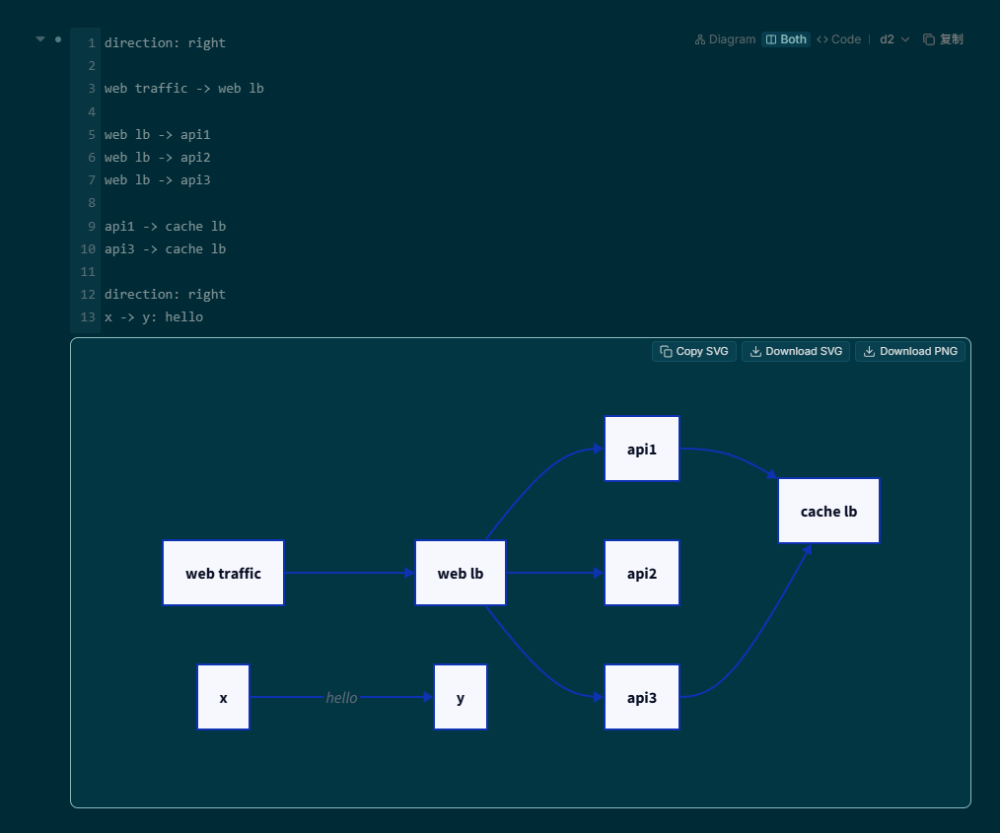

# logseq-d2

A [Logseq](https://logseq.com) plugin that renders [D2](https://d2lang.com) diagrams fully client-side using the official WebAssembly engine.



## Features

- **Fully offline** — the D2 WASM engine is bundled. No server, no token.
- **Native block rendering** — classic builds use Logseq's official fenced-code renderer, so the diagram becomes the block content. The source editor is hidden in preview mode and the virtual list measures the diagram itself.
- **Live previews** — edits re-render after a short debounce.
- **View modes** — on the DB/DOM renderer, every D2 block can show the diagram only, the source plus the diagram, or the source only. A three-way switcher sits in the code-block action bar, and the initial mode is configurable in settings (`diagram` / `both` / `code`).
- **Smooth scrolling** — zero layout shifts and instant diagram recovery. Known diagram dimensions are pre-reserved on remount, eliminating scroll jumps and flickers.
- **Themes and sketch mode** — 20 built-in D2 themes, sketch style, transparent background, and intelligent Auto themes that match Logseq light/dark mode seamlessly.
- **Logseq DB and classic** — official renderer on classic builds, an image-based DOM fallback on DB.
- **Inline errors** — invalid D2 shows a readable message instead of breaking the block.

## Usage

Write a fenced code block with the `d2` language:

````markdown
```d2
direction: right
server -> database: queries
database -> cache: invalidates
```
````

Run `/d2` to insert a starter block.

## Settings

Open **Settings** → **Plugin Settings** → **D2 Diagram Renderer**:

| Setting | Description | Default |
| :--- | :--- | :--- |
| **Light Theme** | Color theme for rendered diagrams. Auto follows Logseq light/dark mode. | `Auto (match Logseq)` |
| **Dark Theme (for Auto mode)** | Dark theme used when Logseq is in Dark Mode. | `Dark Mauve` |
| **Transparent Background** | Let the Logseq card show through instead of drawing a canvas behind the diagram. | `true` |
| **Sketch mode** | Render diagrams in hand-drawn sketch style | `false` |
| **Diagram size** | Scale the rendered diagram (`0.6`–`1.5`) | `1` |
| **Default View Mode** | How a D2 block opens: `diagram` (diagram only), `both` (code and diagram), or `code` (code only). A manual switch on a block lasts until the next full re-render. | `diagram` |

Changing any setting re-renders every diagram on the page and reapplies the current **Default View Mode**. With `Auto`, switching Logseq between light and dark also re-renders diagrams. The D2 canvas background is transparent, so the Logseq card provides the surface.

### View modes

On the DB/DOM renderer, each D2 code block gets a three-way switcher in its action bar:

| Mode | Code editor | Diagram |
| :--- | :--- | :--- |
| **Diagram** | hidden | shown |
| **Both** | shown | shown |
| **Code** | shown | hidden |

Pick the initial state globally with **Default View Mode**; the switcher only changes the block you click. The SVG is still rendered in the background in `code` mode, so switching back to `diagram` or `both` is instant.

## How it works

| Module | Responsibility |
| :--- | :--- |
| `src/main.ts` | Registers settings, the `/d2` command, the fenced-code renderer, and lifecycle hooks. |
| `src/fenced.ts` | Registers a D2 component with Logseq's official fenced-code renderer (classic builds). Renders cached SVGs during the first React render so remounted blocks keep their height. |
| `src/renderer.ts` | DOM fallback for Logseq DB and builds where the official renderer does not fire. Observes `d2` blocks and injects rendered SVGs into preview containers with pre-reserved heights. |
| `src/engine.ts` | Serializes D2 compiles through one WASM worker and caches both SVG and a data-URL image with intrinsic dimensions. |
| `src/errors.ts` | Formats D2 syntax errors for inline display. |
| `src/settings.ts` | Maps plugin settings to D2 render options. |
| `src/styles.ts` | Styles the preview, loading and error states. Every rule is scoped to plugin-owned elements or to native nodes the plugin has marked itself — see the invasiveness contract at the top of the file. |

## Styling scope

The plugin renders inside Logseq's own DOM, so it follows one rule: **extend the defaults, never replace them.**

- Selectors target either the plugin's own elements (`logseq-d2-*`, `d2-seg-*`) or native nodes the plugin has marked itself (`logseq-d2-block`, `logseq-d2-code-actions`, `logseq-d2-fenced`). Those markers are added *and removed* by `src/renderer.ts`.
- `!important` is reserved for overriding a declaration Logseq already puts on the same native element — the code block's own layout and the view-mode visibility toggles. Plugin-owned elements win by specificity instead.
- No global resets, no `body` / `html` / `*` rules, and no app-wide scroll-container patching.

## Development

```sh
pnpm install
pnpm dev       # rebuild on change
pnpm build     # production bundle in dist/
pnpm typecheck
```

In Logseq: **Plugins** → **Load unpacked plugin** → select this repository directory.

## License

[MIT](./LICENSE)
