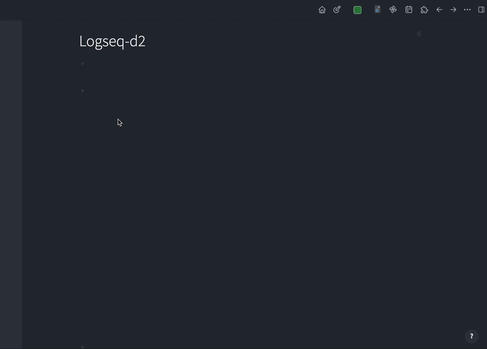

# logseq-d2

A [Logseq](https://logseq.com) plugin that renders [D2](https://d2lang.com) diagrams.

Rendering happens entirely client-side: the official D2 WASM engine
([`@terrastruct/d2`](https://www.npmjs.com/package/@terrastruct/d2), the same
engine behind [play.d2lang.com](https://play.d2lang.com)) is bundled into the
plugin. **No server, no endpoint/token setup, works offline.**



## Usage

Write a fenced code block with the `d2` language. The diagram renders
automatically once you move the cursor away:

````markdown
```d2
server -> database: queries
database -> cache: invalidates
```
````

You can also type `/d2` to insert a code block template. Click a rendered
diagram to edit it.

## Settings

| Setting     | Description                          | Default |
| ----------- | ------------------------------------ | ------- |
| Theme       | Color theme for rendered diagrams    | Default |
| Sketch mode | Render diagrams in hand-drawn style  | off     |

The layout engine is fixed to dagre (the browser WASM build does not bundle ELK).

## Development

```sh
pnpm install
pnpm dev    # watch mode
pnpm build  # bundles into dist/
```

In Logseq: Plugins → Load unpacked plugin → select this directory.

## How it works

Rendering happens entirely client-side: the official D2 WASM engine is bundled
into the plugin, so there is no server and no network involved.

Instead of `registerFencedCodeRenderer` (which does not fire on the Logseq DB
version), the plugin observes the top-level Logseq document with a
`MutationObserver`, finds code blocks tagged as `d2` (via the block's
`data-lang` attribute), and appends the rendered SVG below the code — the same
approach as the [logseq-pele](https://github.com/b-yp/logseq-pele) plugin.
This works on Logseq DB and classic builds alike. Diagrams re-render
automatically (debounced) while you edit the code, and when plugin settings
change.

Compilation and rendering run inside a Web Worker (keeps the UI responsive).
Renders are serialized because the WASM worker cannot handle concurrent calls;
if a render fails, the WASM instance is recreated and the render retried once.

## License

MIT
